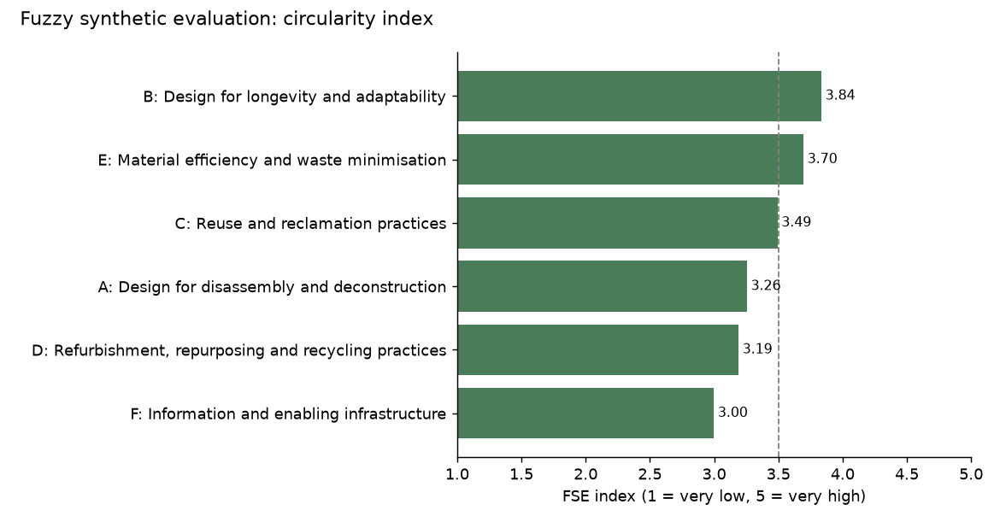
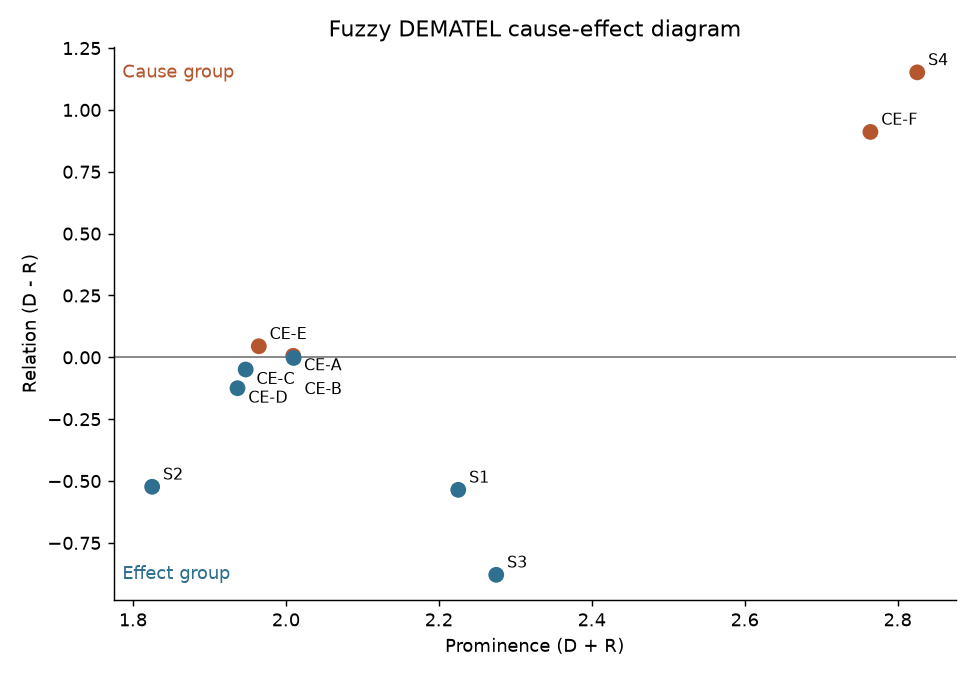

# Fuzzy synthetic evaluation and fuzzy DEMATEL for circular economy and net-zero carbon buildings

This repository holds Python implementations of the two fuzzy decision-making methods in my MSc thesis at KNUST, *Developing an integrated circular economy and net-zero carbon building framework for tropical developing countries* (in progress, 2026):

- **Fuzzy synthetic evaluation (FSE)** ranks 29 circular economy principles and 30 net-zero carbon strategies, and combines professionals' ratings into a circularity index and into separate operational and embodied criticality indices (Objectives One and Two).
- **Fuzzy DEMATEL** separates cause factors from effect factors among six circular principle clusters and four net-zero strategy groups (Objective Three). It includes a leave-one-expert-out check on whether the expert panel is large enough.

> **Data notice.** Everything in `data/` is **synthetic**. It has the same structure as the thesis instruments (385 respondents and 12 experts), but it was simulated, not collected. No real responses are included, and none of the numbers below are findings.

## Methods

### Item ranking and fuzzy synthetic evaluation (`src/fse.py`)

For each item, the script computes:
- mean score and standard deviation
- relative importance index, RII = ΣW / (A × N), with A = 5
- rank
- a one-tailed one-sample t-test against 3.5, to flag items rated significantly applicable

For each group of items, FSE follows Xu et al. (2010) and Ameyaw and Chan (2015):

| Step | Formula |
|---|---|
| Item weight | wᵢ = Mᵢ / ΣMᵢ within the group |
| Membership function | Rᵢ = share of respondents choosing grades 1 to 5 |
| Group membership vector | D = w · R |
| Group index | FSE = Σ D_g × g, for g = 1 to 5 |

A second level weights the groups by their mean scores to give an overall index.

### Fuzzy DEMATEL (`src/fuzzy_dematel.py`)

1. Each expert's linguistic ratings are converted to triangular fuzzy numbers on the Wu and Lee (2007) scale, from "no influence" (0, 0, 0.25) to "very high influence" (0.75, 1, 1).
2. Each expert's matrix is converted to crisp values with CFCS (Opricovic and Tzeng, 2003), and the experts' matrices are averaged.
3. The averaged matrix is normalised, and the total-relation matrix is computed as **T = X(I − X)⁻¹**.
4. Prominence (D + R) and relation (D − R) are calculated. Factors with positive relation form the cause group.
5. Links stronger than the mean of T are reported as significant influences.
6. **Stability check:** T is recomputed with each expert left out in turn. A factor whose relation sits close to zero can switch groups whatever the panel size. So switches inside a borderline band (`--band`, default |D − R| < 0.05) are reported separately from switches of clearly classified factors.

## Example output (synthetic data)

**Circularity index by cluster** (n = 385):



**Operational vs embodied criticality of the strategy groups:**

| Strategy group | Operational index | Embodied index |
|---|---|---|
| S1 Passive form and ventilation | 4.00 | 3.16 |
| S2 Technology- and material-intensive operational measures | 3.86 | 2.43 |
| S3 Low-carbon materials and structural efficiency | 2.89 | 4.06 |
| S4 Whole-life carbon assessment and targets | 3.20 | 3.67 |

**Fuzzy DEMATEL cause-effect diagram** (12 experts, 10 factors):



In the synthetic panel, whole-life carbon assessment (S4) and information and enabling infrastructure (CE-F) form a clear cause group. The stability check fails under the strict "no factor may switch" rule. It passes once the four borderline clusters (CE-A, CE-B, CE-C, CE-E, all with |D − R| < 0.05) are set aside. A borderline factor is best reported as weakly classified, rather than treated as evidence that the panel is too small.

## Reproducibility

The data and results in this repository are produced by the code itself. A GitHub Actions workflow (`.github/workflows/reproduce.yml`) regenerates the synthetic data and reruns every analysis whenever the code changes, then commits the outputs.

## How to run it

```bash
git clone https://github.com/bernard-frimpong/fuzzy-decision-methods.git
cd fuzzy-decision-methods
pip install -r requirements.txt

python src/generate_synthetic_data.py            # optional: rebuild the synthetic data

# Objective One: circularity index
python src/fse.py --ratings data/synthetic_ce_ratings.csv --items data/ce_items.csv --label circularity

# Objective Two: operational and embodied criticality indices
python src/fse.py --ratings data/synthetic_nzs_operational.csv --items data/nzs_items.csv --label operational
python src/fse.py --ratings data/synthetic_nzs_embodied.csv --items data/nzs_items.csv --label embodied

# Objective Three: fuzzy DEMATEL with stability check
python src/fuzzy_dematel.py --data data/synthetic_dematel_experts.csv --band 0.05
```

### Using your own data

- **Ratings:** a CSV with one row per respondent and one column per item code, scored 1 to 5.
- **Items:** a CSV with the columns `code`, `group`, `item`.
- **DEMATEL:** long format with the columns `expert`, `from`, `to`, `rating`, where ratings run from 0 to 4 (no influence to very high influence).

## Outputs (`results/`)

| File | Contents |
|---|---|
| `<label>_item_ranking.csv` | Mean, SD, RII, rank and t-test for every item |
| `<label>_fse_index.csv` | Membership vector, FSE index, weight and rank for each group |
| `<label>_fse_index.png` | Bar chart of group indices |
| `dematel_total_relation.csv` | Total-relation matrix T |
| `dematel_cause_effect.csv` | D, R, prominence, relation and role of each factor |
| `dematel_significant_links.csv` | Influences above the threshold |
| `dematel_stability.csv` | Leave-one-expert-out results |
| `dematel_cause_effect.png` | Cause-effect diagram |

## References

- Ameyaw, E. E., & Chan, A. P. C. (2015). Evaluation and ranking of risk factors in public–private partnership water supply projects in developing countries using fuzzy synthetic evaluation approach. *Expert Systems with Applications, 42*(12), 5102–5116.
- Opricovic, S., & Tzeng, G.-H. (2003). Defuzzification within a multicriteria decision model. *International Journal of Uncertainty, Fuzziness and Knowledge-Based Systems, 11*(5), 635–652.
- Wu, W.-W., & Lee, Y.-T. (2007). Developing global managers' competencies using the fuzzy DEMATEL method. *Expert Systems with Applications, 32*(2), 499–507.
- Xu, Y., Yeung, J. F. Y., Chan, A. P. C., Chan, D. W. M., Wang, S. Q., & Ke, Y. (2010). Developing a risk assessment model for PPP projects in China: A fuzzy synthetic evaluation approach. *Automation in Construction, 19*(7), 929–943.

## Author

**Bernard Boakye Frimpong**, MSc Construction Management candidate, Kwame Nkrumah University of Science and Technology (KNUST), Ghana.
[GitHub](https://github.com/bernard-frimpong) · [Google Scholar](https://scholar.google.com/citations?user=fq_SHroAAAAJ&hl=en) · [ORCID](https://orcid.org/0009-0007-3664-3541)

Released under the MIT License.
